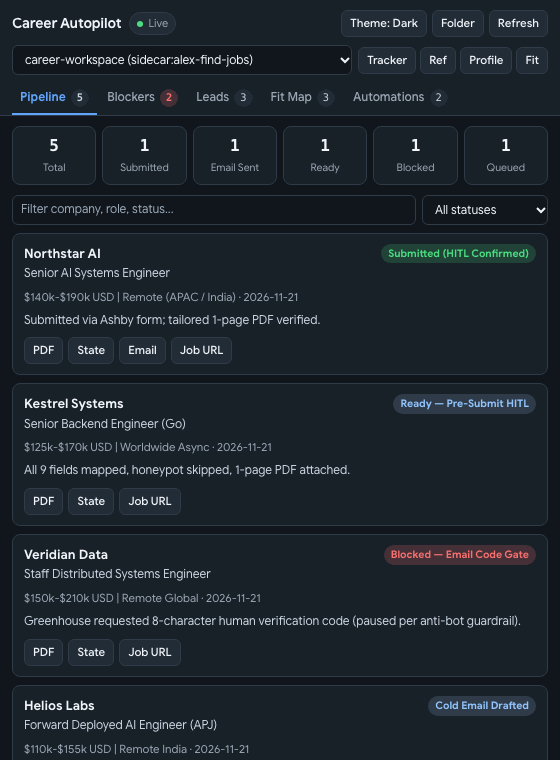

# Career Autopilot

Career Autopilot is an Antigravity plugin and automation kit for running a structured job search. It parses your existing resume into a canonical profile, scouts and screens job boards, tailors 1-page PDF resumes, fills web application forms in a browser, and drafts cold outreach emails for your approval.

All personal data stays outside this repository. Your resume, preferences, phone number, and application history live in a separate private workspace protected by `.gitignore`.

The default settings target candidates based in India (`Asia/Kolkata`, `IST / UTC+5:30`, INR/USD/EUR compensation floors, remote Employer of Record [EOR] and contractor checks, `+91` phone handling, and `A4` or `Letter` PDFs). You can change country, timezone, currency, work mode (`remote`, `hybrid`, `onsite`), and job domain during onboarding.

## Extension UI

When installed, `career-autopilot` adds a side-pane Extension in Antigravity (`sidecar://<install-dir>/dashboard/`, typically `sidecar://career-autopilot/dashboard/`) that follows Antigravity's dark and light themes (with a manual `Auto / Dark / Light` toggle), opens tailored PDFs, logs, and notes directly inside the editor, and lets you configure scheduled automations without running shell scripts. Enable the `career-autopilot/dashboard` sidecar in Antigravity's **Extensions / Customizations** panel if it starts turned off.



## Requirements

- [Antigravity](https://antigravity.google/docs) with plugin support (the dashboard sidecar runs on Antigravity's bundled Node runtime)
- `git` (for Git-only install and updates) or the Antigravity CLI (`agy`)
- Google Chrome, Chromium, or Microsoft Edge (used in headless mode to render 1-page PDFs)
- macOS, Linux, or Windows with WSL / Git Bash (`bash`, `awk`, `sed`, `grep`, `unzip` are used by helper scripts, `.docx` parsing, and the POSIX safety hook; `render_resume_pdf.ps1` also supports native PowerShell PDF rendering)
- Optional: the Antigravity Gmail plugin for creating email drafts (without it, outreach saves as copy-paste Markdown files)

## How it works

The plugin splits the job search into three core phases plus an optional fit-rubric step, backed by an editing skill (`clear-natural-english`) that keeps summaries, essays, and emails plain and free of AI filler:

1. **Phase 0 — Onboard (`career-autopilot-onboard`):** Extracts facts, dates, and verified metrics from your `.pdf`, `.docx`, or `.md` resume into `resume/master_profile.md`, interviews you to populate `GLOBAL_REFERENCE.md`, and renders a 1-page baseline PDF.
2. **Phase 1 — Scout (`career-autopilot-scout`):** Searches Ashby, Greenhouse, Lever, YC Jobs, Hacker News Who is Hiring, Notion, Breezy, and custom portals (`Mode A` public page inspection or `Mode B` authenticated Chrome `--autoConnect` via `chrome-devtools` MCP). Deduplicates against your tracker, checks compensation and years-of-experience fit, flags location-adjusted pay, and tiers leads into `applications/new_leads.md` and `applications/tracker.md`.
3. **Optional — Fit rubric and prep map (`career-autopilot-fit`):** Generates `requirements/README.md` and per-track guides with a Mermaid mind-map, dual-track eligibility gate (`>= 80%` verified skill match or wanted specialty track), instant-skip mismatch filters, and a focused interview prep queue. When present, `career-autopilot-scout` and `career-autopilot-apply` enforce its triage gate before queuing or tailoring.
4. **Phase 2 — Apply (`career-autopilot-apply`):** Fans out up to 32 isolated workers (one per company folder) to tailor 1-page resumes and map form fields, runs serialized browser file uploads from the root coordinator, and prepares cold-email drafts when a public contact email is verified.

## Safety rules

- **Pre-submit pause by default:** Web applications run in `hitl_pre_submit` (human-in-the-loop) mode out of the box. The agent fills mapped fields, attaches a `[TODO:`-free 1-page PDF, takes a screenshot, and stops before clicking Submit. During onboarding, you can optionally opt into `yolo_with_guardrails`, which auto-accepts standard privacy/AI-disclosure checkboxes and clicks Submit on clean forms.
- **Hard stops on human gates:** Even in `yolo_with_guardrails` mode, the agent stops immediately on CAPTCHAs, email human-verification codes (it never reads your inbox to bypass human checks), login or MFA walls, anti-LLM authorship checks, and unusual legal terms (broad non-competes, outside-work IP assignment, or device surveillance).
- **Prompt-injection and honeypot defense:** Job descriptions and form labels are treated as untrusted text. Hidden off-screen inputs are left blank, and embedded prompt-injection tokens are stripped.
- **No automatic emails:** Cold outreach never guesses email addresses and never sends without your explicit approval in chat after showing the exact recipient, subject, body, and PDF path. Scheduled runs are blocked from sending email at both the permission and hook layers.
- **Grounded facts only:** Resumes, form answers, and emails draw only from `resume/master_profile.md` and its locked quantitative baseline. The PDF renderer exits with an error if any `[TODO:` or `[USER INPUT NEEDED` placeholder remains.

## Quickstart

### 1. Install the plugin

This repository is a root-level Antigravity plugin (`plugin.json` and `hooks.json` live at the repository root, with `workspace-template/` and `automations/` bundled alongside them). Pick whichever install method fits your setup:

**Option 1: Antigravity CLI (`agy`)**

```bash
agy plugin install https://github.com/nikeshthapa255/career-autopilot
```

This installs the plugin into Antigravity's global plugins directory (`~/.gemini/config/plugins/career-autopilot` on macOS/Linux/WSL). Re-run the same command to update later, or manage/uninstall it from Antigravity's **Customizations** panel.

**Option 2: Git only (no CLI needed)**

First make sure `~/.gemini/config/plugins/career-autopilot` does not already exist (duplicate plugin `name` entries are dropped silently), then clone:

```bash
git clone https://github.com/nikeshthapa255/career-autopilot ~/.gemini/config/plugins/career-autopilot
```

To update a Git install later:

```bash
git -C ~/.gemini/config/plugins/career-autopilot pull
```

**Verify after install:** Start a new Antigravity session and open **Customizations** in Antigravity (or click `customization://career-autopilot` in chat) to confirm **Career Autopilot** is enabled. For project-scoped installation via `.agents/plugins.json`, see [docs/antigravity-plugin-and-sidecar-spec.md](docs/antigravity-plugin-and-sidecar-spec.md#51-installation-options-zero-configjson-edits).

### 2. Run onboarding in a private workspace

Keep your resume and application records outside the plugin directory. Open any empty local folder (for example `~/career-workspace`) in Antigravity, attach your current resume (`.pdf`, `.docx`, or `.md`) in chat or paste its file path, and ask the agent to run `career-autopilot-onboard` (or click the first starter prompt on the **Career Autopilot** card in Customizations).

The onboarding skill automatically scaffolds the workspace from the bundled `workspace-template/`, creates `resume/master_profile.md`, fills out `GLOBAL_REFERENCE.md` through a short interview, and verifies your 1-page baseline PDF.

If you prefer scaffolding the workspace from the terminal first (replace `<plugin-dir>` if you installed under a custom path; default is `~/.gemini/config/plugins/career-autopilot`):

```bash
~/.gemini/config/plugins/career-autopilot/skills/career-autopilot-onboard/scripts/init-workspace.sh ~/career-workspace
```

### 3. Scout matching roles

Ask Antigravity to run `career-autopilot-scout`. Verified leads land in `applications/new_leads.md` and `applications/tracker.md`.

### 4. Tailor and apply

Ask Antigravity to run `career-autopilot-apply` on your queued roles. Each target gets its own folder under `applications/<company-slug>/` holding the tailored HTML, 1-page PDF, form state log, and optional email draft.

## Scheduled automations

After completing onboarding (Step 2), you can run discovery and application prep on a cron schedule. Open the **Career Autopilot** side-pane in Antigravity (`sidecar://career-autopilot/dashboard/`), switch to the **Automations** tab, set your schedules and timezone, and click **Save Sidecar Configs**.

If you prefer the CLI installer (pass `--no-gmail` if you do not use the Gmail plugin):

```bash
~/.gemini/config/plugins/career-autopilot/automations/install-sidecars.sh --workspace ~/career-workspace --tz Asia/Kolkata
```

Both methods prefix sidecar IDs and dashboard names with your first name (`<firstname>-find-jobs` and `<firstname>-auto-apply`, overridable via the form or `--prefix`) and install them disabled by default. Review and turn them on manually from Antigravity's **Automations** panel (`sidecar://dashboard`).

See [automations/README.md](automations/README.md) for custom schedules, Gmail vs. copy-paste email flags, and `--dry-run` previews.

## Repository layout

| Path | Contents |
| :--- | :--- |
| [plugin.json](plugin.json), [hooks.json](hooks.json), [rules/AGENTS.md](rules/AGENTS.md) | Root Antigravity plugin manifest, `PreToolUse` safety hook config ([hooks/pre_tool_safety.sh](hooks/pre_tool_safety.sh)), and always-on guardrails |
| `skills/` | 5 bundled skills: [career-autopilot-onboard](skills/career-autopilot-onboard/SKILL.md), [career-autopilot-scout](skills/career-autopilot-scout/SKILL.md), [career-autopilot-fit](skills/career-autopilot-fit/SKILL.md) (optional), [career-autopilot-apply](skills/career-autopilot-apply/SKILL.md), and [clear-natural-english](skills/clear-natural-english/SKILL.md) |
| `agents/` | Subagent definitions: read-only [career-autopilot-scout](agents/career-autopilot-scout.md) and per-company [career-autopilot-worker](agents/career-autopilot-worker.md) |
| `sidecars/dashboard/` | Live Antigravity side-pane UI Extension ([sidecar.json](sidecars/dashboard/sidecar.json)) with dark/light theme support and inline Automations configurator |
| `workspace-template/` | Starter files for a private candidate workspace ([GLOBAL_REFERENCE.md.template](workspace-template/GLOBAL_REFERENCE.md.template), `master_profile.md.template`, `tracker.md.template`, `new_leads.md.template`, optional `requirements/README.md.template`) |
| `automations/` | Parameterized scheduled sidecar templates (`find-new-jobs`, `auto-apply`), `install-sidecars.sh`, and [automations/README.md](automations/README.md) |
| `docs/` | [Framework architecture](docs/framework-architecture.md), [plugin and sidecar spec](docs/antigravity-plugin-and-sidecar-spec.md), [browser architecture](docs/browser-extension-architecture.md), and [onboarding guide](docs/onboarding-guide.md) |
| `tests/` | [Zero-PII scanner](tests/test_zero_pii_scan.sh), [PDF renderer & JSON tests](tests/test_render_resume_pdf.sh), and synthetic HTML fixtures |

## Verification tests (contributors / local checkouts)

From a cloned copy of this repository (or `~/.gemini/config/plugins/career-autopilot`), run:

```bash
./tests/test_zero_pii_scan.sh
./tests/test_render_resume_pdf.sh
```

For macOS, Linux, WSL, and Windows Chrome setup and troubleshooting, see [docs/onboarding-guide.md](docs/onboarding-guide.md).
